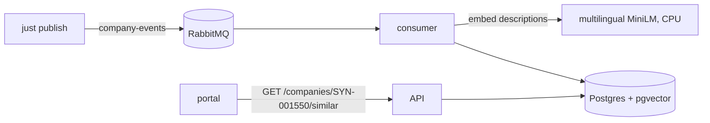

# Company recommendation system

A "Similar companies" service built for the OneCredit [MLE take-home](https://github.com/OneCreditMY/mle-take-home).
A **consumer** reads the registry feed from RabbitMQ and stores each company in Postgres with an embedding of its
business description (pgvector). An **API** returns the most similar companies for any company, searched in Postgres.



The decisions, assumptions, what I'd change at 10x volume, and what's left are in **[DESIGN.md](DESIGN.md)**.

## Run it

You need Docker, [uv](https://docs.astral.sh/uv/) and [just](https://github.com/casey/just). On Windows, `just` runs
recipes with `bash`, so install Git for Windows.

```bash
just setup      # install dependencies
just up         # start Postgres (pgvector) and RabbitMQ
just publish    # put the registry feed on the queue (the queue keeps it until a consumer reads it)

just consumer   # terminal 1: consume the queue and fill Postgres; stops with Ctrl+C
just serve      # terminal 2: the API on http://127.0.0.1:8000 (interactive docs at /docs)
```

- The first `just consumer` downloads the embedding model (about 220 MB, once). Then the whole feed takes a few
  seconds. For a run that exits by itself once the queue is empty: `just consumer --idle-exit 5`.
- You can start `just serve` before or after the consumer. It creates the schema itself and answers 503 until the
  database is reachable.
- `just publish` can be run again at any time. Replaying the feed leaves the database unchanged (this is tested).
- `just down` stops everything and **deletes the data**; run `just up` and `just publish` again afterwards.
- Ports are taken from `POSTGRES_PORT`, `RABBITMQ_PORT` and `RABBITMQ_UI_PORT`, as in the original setup. To point
  at other servers, set `DATABASE_URL` or `RABBITMQ_URL`. Their defaults use `127.0.0.1` rather than `localhost`,
  because on Windows `localhost` tries IPv6 first and can stall.

## Use it

```bash
curl "http://127.0.0.1:8000/companies/SYN-001550/similar?limit=3"
```

```json
{
  "registrationNumber": "SYN-001550",
  "similar": [
    {"registrationNumber": "SYN-000539", "companyName": "Seri Sejahtera Food Sdn. Bhd.",
     "industry": "Food & Beverage", "state": "Johor", "similarity": 1.0},
    {"registrationNumber": "SYN-000263", "companyName": "Gemilang Delima Food Sdn. Bhd.",
     "industry": "Food & Beverage", "state": "Johor", "similarity": 0.9497},
    {"registrationNumber": "SYN-001650", "companyName": "Everbright Pacific Food Sdn. Bhd.",
     "industry": "Food & Beverage", "state": "Kuala Lumpur", "similarity": 0.9497}
  ]
}
```

Most similar first. `limit` is 1 to 50 (default 5). `industry` and `state` are `null` when the registry did not
send them. `similarity` is cosine similarity: use it to order, not as a percentage.

| Response | When |
|---|---|
| 200, `similar: []` | The company is known but has nothing to compare against |
| 404 | Unknown registration number |
| 422 | Malformed registration number, or `limit` out of range |
| 503 + `Retry-After: 5` | Database unavailable. The portal should hide the panel rather than fail the page |

`GET /health` returns 200 only if the database answers.

Messages the consumer could not apply (truncated JSON, no registration number, and so on) are kept, with the reason,
in the `dead_letters` table:

```bash
docker compose exec postgres psql -U postgres -d companies -c "SELECT reason, count(*) FROM dead_letters GROUP BY 1"
```

## Test it

```bash
just test       # 64 tests; the integration tests need `just up` and skip themselves if Postgres is down
just evaluate   # compare embedding models on the stored companies (needs the consumer to have run)
```

The integration tests use a throwaway `companies_test` database, never the `companies` database the service uses.

## Layout

```
recsys/
  parsing.py     # raw message -> clean event, or rejected with a reason
  company.py     # the stored company and the rule for merging events into it
  consumer.py    # RabbitMQ consumer: batches, ack after commit, dead letters
  embedding.py   # the embedding model
  db.py          # schema and queries used by the consumer
  schema.sql     # tables and the HNSW index
  search.py      # the nearest-neighbour query
  api.py         # FastAPI app
scripts/evaluate_models.py   # precision@5 per embedding model
tests/                       # unit tests, plus integration tests against Postgres
data/, producer/             # the registry feed and its publisher (unchanged from the template)
```
